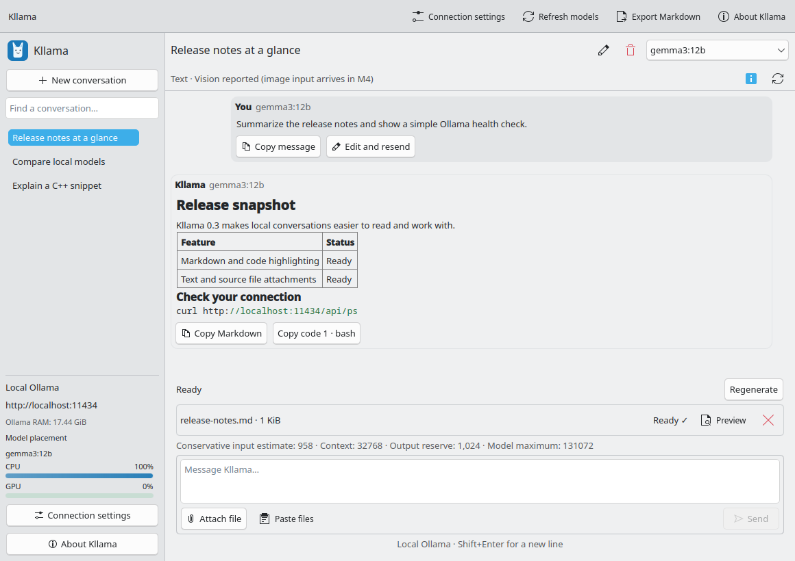

# Kllama

A native KDE frontend for Ollama, built with C++20, Qt 6, and Kirigami.



*Native KDE interface with demonstration content.*

## M3: Markdown and text attachments

Kllama now includes an About dialog, streaming chat, full conversation history in requests, Stop, retry/regenerate, and edit-and-resend with explicit replacement of later messages. Conversations, per-chat models, and drafts are stored in SQLite; interrupted responses retain partial text. The sidebar supports title search, rename, and deletion. Only one app instance may write to a data directory at a time.

Assistant responses render selectable Markdown: headings, emphasis, lists, quotes, tables, links, inline code, and fenced code with basic keyword/string/comment highlighting. User messages remain plain text. Copy Markdown preserves the raw response, and code copy excludes fences. Export Markdown saves the conversation and attached filenames; it does not bundle the attachment contents. Enter sends and Shift+Enter inserts a newline; reverse this in Connection settings. Copy/paste context menus and standard keyboard shortcuts work in the composer and transcript. History navigation, connection/model changes, and edits are disabled during generation; Stop first. You can draft your next message while waiting.

Local statistics sample accessible Ollama process RSS, including model runners and other descendants, every five seconds off the UI thread. The sum includes other Ollama sessions, may double-count shared pages, and is not GPU memory. Remote statistics count outgoing chat and capability-inspection JSON payloads, received API payloads, and their combined recent transfer rate, excluding HTTP/TLS overhead and other clients. Counters reset when saving a connection or restarting Kllama; Refresh reuses the current counter session.

The sidebar shows animated CPU/GPU **model placement** bars for each loaded model, refreshed every five seconds through `GET /api/ps`. Percentages follow the model memory split reported by Ollama (`size` and `size_vram`), as in `ollama ps`; they do not measure processor activity or total hardware capacity. This works with local and remote endpoints without installing an agent. No loaded models and unavailable/unsupported metrics are shown explicitly. Remote payload counters include these polling responses. True remote CPU/GPU activity and host RAM monitoring would require a separate authenticated host telemetry service; the standard Ollama endpoint does not provide those measurements.

Requests time out after three minutes without incoming bytes. Stream records are capped at 2 MiB and total responses at 16 MiB. Partial output is checkpointed approximately once per second and saved on Stop/normal exit. The app requests non-thinking output (`think: false`); if the backend nevertheless sends thinking events, the activity label reports processing without presenting them as answer text. Tools are not executed in M3.

## Attach files and inspect models

Use Attach file, drop local files onto the chat, paste copied file URLs with Ctrl+V, or use Paste files. Ordinary clipboard text continues to paste into the composer. M3 accepts valid UTF-8 text/code, Markdown, JSON, CSV, and similar textual inputs: up to eight files, each at most 512 KiB. Empty files, unsupported binary/image/document content, invalid UTF-8, oversized files, and duplicate content receive explicit errors. Cancel, retry, remove, and inspect the exact extracted text with Preview. Navigation waits for preparation to finish or be cancelled; the background worker pool is limited to two jobs.

Attachments belong to the conversation and are included as delimited reference material on subsequent requests. Kllama retains an owner-readable/writable managed original and extracted text, so removing the external source does not break a reopened conversation. Remove deletes the managed copy; deleting the conversation deletes its managed attachment directory. Original source files are never changed.

Model inspection uses `POST /api/show`, not a chat prompt. The summary and Model details report metadata from the current endpoint/model. Results are cached in memory by endpoint, model, and digest (or modification identity), and refreshed after identity changes; explicit inspection refresh discards cached results. Late replies from a previous selection are ignored. Failed or missing metadata is shown as unknown, never as confirmed native attachment support. Reported vision support is displayed, but native images and PDF/DOCX extraction remain M4. M3 does not infer arbitrary file support from a model family such as Qwen.

## Context budget and Markdown resources

The context setting defaults to 4,096 tokens and is capped by the model maximum when metadata reports one. Kllama supplies this explicit `num_ctx` and a 1,024-token output cap to Ollama. The input estimate conservatively counts UTF-8 bytes plus message/file overhead, reserves 1,024 output tokens and 256 safety tokens, and blocks sending when the estimate will not fit. Details explains how to remove/shorten content, start a new conversation, or increase context in Connection settings. Drafts and history remain intact on a blocked send. Model maxima may be unknown and the estimate is not a tokenizer count; Kllama never truncates input itself.

Connection settings → **Use model maximum automatically** selects the context limit reported by the current model. If unavailable, Kllama uses the saved manual limit until discovery succeeds. Turning it off restores the manual limit. Maximum context can substantially increase memory use.

Markdown is parsed with HTML disabled. Image resources, including local/data URLs, are removed before presentation; there is no automatic remote-image loading. Only explicit user activation opens HTTP/HTTPS links. Incomplete fenced blocks remain readable during streaming. Rendering updates are throttled, delegates stay in place, and selected text is restored where the same text remains after reformatting.

## Build on Fedora 44

```bash
sudo dnf install cmake gcc-c++ ninja-build extra-cmake-modules \
  qt6-qtbase-devel qt6-qtdeclarative-devel kf6-kirigami-devel \
  kf6-ki18n-devel kf6-qqc2-desktop-style
cmake -S . -B build -G Ninja -DCMAKE_BUILD_TYPE=Debug
cmake --build build
ctest --test-dir build --output-on-failure
cmake --build build --target register-desktop
./build/bin/kllama
```

Minimum declared versions: Qt 6.6 and KDE Frameworks 6.8. The primary acceptance environment is the Fedora 44 / Plasma 6 / Wayland machine described in [ROADMAP.md](ROADMAP.md). Exact installed development-package versions and validation results are recorded in [VALIDATION.md](VALIDATION.md).

### Desktop integration for development builds

`register-desktop` installs a per-user launcher and icon under `${XDG_DATA_HOME:-~/.local/share}`. Its launcher points to this build's absolute executable path. This also lets the host desktop portal resolve `org.kllama.Kllama` when launching `build/bin/kllama` directly. Re-run the target after moving the build. Registration is explicit; ordinary builds and tests do not modify your desktop entries.

If you see `Could not register app ID: App info not found`, run `cmake --build build --target register-desktop`, then restart Kllama. No sudo is needed. A normal installed package supplies the entry instead. To remove this development registration, delete only `applications/org.kllama.Kllama.desktop` and `icons/hicolor/scalable/apps/org.kllama.Kllama.svg` beneath your user data directory.

Optional staged install (no root needed; staging does not register with your running desktop):

```bash
DESTDIR="$PWD/build/stage" cmake --install build --prefix /usr
```

The build installs a desktop entry, scalable icon, and AppStream metadata. RPM packaging is planned for the stable-release milestone. `org.kllama.Kllama` is a provisional application identifier, not a claim of domain ownership or KDE project membership.

## Connect

Run Ollama separately (`ollama serve` when no service is already running). Kllama defaults to `http://localhost:11434`. Open Connection settings for a remote hostname or IP, including scheme and port. Local mode only accepts `localhost`, `127.0.0.1`, or `[::1]` to avoid showing this computer's RAM for a remote server. No credentials are stored in URLs, redirects are not followed, and remote authentication is outside M3.

If there are no models, install one with `ollama pull <model>` in a terminal, then refresh. Kllama never starts a server or downloads models automatically.

## Translation

User-facing strings use KI18n in C++ and QML. `po/Messages.sh` is the extraction entry point for KDE translation tooling (`XGETTEXT`/`podir`); `ki18n_install(po)` installs language catalogs when supplied. No translated catalogs are included yet.

## Stored data

The About dialog shows the data directory. Its `conversations.sqlite` file contains unencrypted chats and drafts with owner-only database permissions. Schema version 2 stores attachment metadata and recovers in-progress messages as interrupted on startup. M2 schema-1 databases migrate automatically after a consistent `conversations-v1-backup.sqlite` backup is made; newer unknown schemas and invalid message data are preserved and reported as storage errors. Delete a conversation to remove its active records and managed attachments; this is logical deletion, not guaranteed forensic erasure from SQLite free pages or backups. Migration backups remain until you explicitly remove them.

## Development checks

The QtTest suites use isolated settings/data directories and loopback HTTP fixtures. They cover model discovery, split/coalesced UTF-8 stream records, malformed/truncated responses, HTTP errors, cancellation, history assembly, regeneration, edits, storage recovery, code copying, keyboard sending/newlines, clipboard round trips, and selection retention during streaming. M3 tests also cover capability caching and invalidation, missing metadata, stale replies, file validation/cancellation/duplicates, managed-copy recovery/deletion, schema migration, context blocking, Markdown isolation/highlighting, file-URL paste/drop, and file preview. Offscreen smoke tests open settings and About. Native Wayland acceptance is recorded in [VALIDATION.md](VALIDATION.md).

Normal tests never contact the user's Ollama server. An explicit local inference check is available:

```bash
KLLAMA_LIVE_TEST=1 KLLAMA_LIVE_MODEL=gemma4:e4b \
  QT_QPA_PLATFORM=offscreen ./build/bin/m3test liveAttachment
```

`--smoke-test` opens settings and About then exits. `--screenshot <absolute-path.png>` captures the window and exits. `KLLAMA_NO_AUTOCONNECT=1` skips the initial API request. Use isolated `XDG_DATA_HOME` and `XDG_CONFIG_HOME` directories for manual UI test runs.
